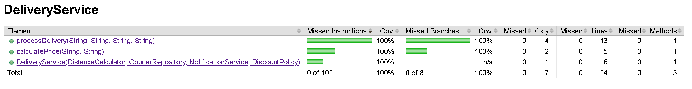

[](https://github.com/LeonidGorbunov/java-unit-testing-delivery-ju5/actions/workflows/ci.yml)
[](https://leonidgorbunov.github.io/java-unit-testing-delivery-ju5/)
# Java Unit Testing Delivery Service Project

**Контекст и цели проекта**: разработка изолированных модульных тестов для верификации расчёта стоимости доставки, подбора и назначения курьеров, а также условной отправки SMS-уведомлений в зависимости от типа транспорта курьера и доступности внешнего SMS-шлюза.

**ТЗ (вид работ)**: модульное тестирование (Unit Testing), параметризация данных (JUnit 5), Mock- и Spy-изоляция (Mockito), частичный стаббинг шпиона (`doReturn().when()`), верификация побочных эффектов (`verify` с `description()`), негативное тестирование и анализ граничных значений.

**Продукт**: Java-модуль сервиса управления доставкой `DeliveryService` (расчёт тарифов с учётом политики скидок, распределение заказов между курьерами и уведомление клиентов при доступном SMS-шлюзе).

**Выполненные задачи**:
1. **Моделирование и изоляция (`@Mock` и `@Spy`):** обеспечена 100% изоляция класса `DeliveryService` от внешних зависимостей (`DistanceCalculator`, `CourierRepository`, `DiscountPolicy`) через генерацию Mock-объектов, а также обёртывание `NotificationService` в Spy-объект для контроля отправки SMS и управления доступностью шлюза.
2. **Частичное мокирование шпиона (`doReturn().when()`):** реализована подмена метода `NotificationService.isSmsGatewayAvailable()` на объекте `@Spy` без вызова реальной реализации (которая в изолированном окружении выбрасывает `UnsupportedOperationException`), при сохранении реального выполнения `sendSms()`.
3. **Комплексная параметризация (JUnit 5):** спроектированы параметризованные наборы тестов через `@CsvSource` и `@MethodSource` для валидации расчёта стоимости доставки, включая проверку граничного нулевого расстояния (`0.0` км), и ветвления логики уведомлений.
4. **Верификация полиморфизма и строковых шаблонов:** протестировано поведение метода `processDelivery` для разных типов курьеров (`Courier` и наследник `CarCourier`) с проверкой точного текста SMS-уведомлений.
5. **Контроль побочных эффектов (`verify` + `description`):** протестирована корректность вызова методов назначения заказа курьеру (`assignOrderToCourier`), отправки сообщения клиенту (`sendSms`) и отсутствия вызова (`never()`) при недоступном SMS-шлюзе с информативными сообщениями об ошибках.
6. **Негативное тестирование и устойчивость бизнес-логики:** проверена генерация исключений `IllegalArgumentException` (при отрицательном расстоянии) и `IllegalStateException` (при отсутствии свободных курьеров), а также успешное завершение оформления доставки при недоступном SMS-шлюзе.
7. **Тестовое покрытие (Code Coverage):** достигнуто 100% покрытие инструкций и веток (`Instructions` и `Branches`) целевой бизнес-логики класса `DeliveryService` с помощью плагина JaCoCo.

**Область тестирования (Scope)**: корректность расчёта стоимости с учётом скидок, обработка исключительных состояний, полиморфная логика выбора шаблона уведомления, ветвление при доступности/недоступности SMS-шлюза, верификация вызовов внешних сервисов.

**Окружение**: Java (JDK 11), JUnit 5 (Jupiter 5.11.0), Mockito (5.11.0), Maven, JaCoCo Plugin (0.8.12).

---

### Архитектура проекта и подход к изоляции

Класс `DeliveryService` получает все зависимости через **Constructor Injection**, что позволяет полностью изолировать его бизнес-логику от смежных модулей в рамках модульного тестирования:

```text
src/
├── main/java/com/springfield/delivery/
│   ├── DeliveryService.java          # Целевой сервис (расчёт стоимости, назначение курьера и условная отправка SMS)
│   ├── DistanceCalculator.java       # Калькулятор расстояний между пунктами (изолирован @Mock)
│   ├── CourierRepository.java        # Репозиторий поиска и назначения курьеров (изолирован @Mock)
│   ├── DiscountPolicy.java           # Интерфейс расчёта скидок (изолирован @Mock)
│   ├── RegularDiscountPolicy.java    # Базовая политика скидок (5%)
│   ├── VipDiscountPolicy.java        # VIP-политика скидок (15%)
│   ├── NotificationService.java      # Сервис проверки шлюза и отправки SMS (обёрнут в @Spy)
│   ├── Courier.java                  # Базовая модель пешего курьера
│   └── CarCourier.java               # Наследник для автокурьера (полиморфизм транспорта)
└── test/java/com/springfield/delivery/
    └── DeliveryServiceTest.java      # Набор изолированных модульных тестов (15 запусков)
```

### Ключевые инженерные решения в тестах

* **Комбинирование `@Mock` и `@Spy` (`doReturn().when()`):** внешние источники данных и правил (`DistanceCalculator`, `CourierRepository`, `DiscountPolicy`) заменены на моки (`@Mock`), тогда как `NotificationService` обёрнут в шпиона (`@Spy`). Проверка доступности шлюза (`isSmsGatewayAvailable()`) перехватывается через `doReturn(true/false).when(notificationServiceSpy)` без запуска реального метода, а реальный `sendSms()` выполняется и отслеживается через `verify()`.
* **Атомарность проверок и диагностика (`verify` + `description`):** каждый тест проверяет строго одно поведение или возвращаемое значение, а все вызовы `verify(..., description(...))` и `verify(..., never().description(...))` снабжены поясняющими сообщениями для быстрой локализации сбоев.
* **Параметризация и полиморфизм:**
  * `@CsvSource` проверяет расчёт итоговой стоимости доставки для различных маршрутов, включая граничное нулевое расстояние (`0.0` км).
  * `@MethodSource` обеспечивает сквозной прогон сценариев оформления доставки для базового класса `Courier` и подкласса `CarCourier`.
* **Точечный отчёт `JaCoCo`:** в `pom.xml` настроен фильтр `<include>com/springfield/delivery/DeliveryService.class</include>` на этапе генерации отчёта, чтобы исключить вспомогательные классы-заглушки и отразить фактическое 100% покрытие всех инструкций и веток целевого сервиса.

---

### Покрытые тестовые сценарии (`DeliveryServiceTest`)

| Метод теста | Аннотация | Проверяемая логика и граничные условия |
| :--- | :--- | :--- |
| `shouldCalculatePriceThrowExceptionWhenCalculateDistanceInKmReturnNegative` | `@Test` | Выброс `IllegalArgumentException` при получении отрицательного расстояния (`-1.0` км) |
| `shouldCalculatePriceReturnPrice` | `@ParameterizedTest` (`@CsvSource`) | Корректный расчёт итоговой стоимости доставки с учётом тарифа и скидки (4 набора данных, включая границу `0.0` км) |
| `shouldProcessDeliveryThrowExceptionWhenAvailableCouriersIsEmpty` | `@Test` | Выброс `IllegalStateException` при пустом списке доступных курьеров (`List.of()`) |
| `shouldProcessDeliverySendNotificationServiceSms` | `@ParameterizedTest` (`@MethodSource`) | Проверка отправки SMS через `@Spy` (при `isSmsGatewayAvailable() -> true`) с разным текстом для пешего курьера (`Courier`) и автокурьера (`CarCourier`) |
| `shouldProcessDeliveryReturnCourierName` | `@ParameterizedTest` (`@MethodSource`) | Возврат имени первого доступного курьера при успешном оформлении доставки и доступном SMS-шлюзе |
| `shouldReturnCourierNameWhenSmsGatewayUnavailable` | `@ParameterizedTest` (`@MethodSource`) | Возврат имени назначенного курьера без блокировки оформления заказа при недоступном SMS-шлюзе (`isSmsGatewayAvailable() -> false`) |
| `shouldProcessDeliveryAssignOrderToCourier` | `@ParameterizedTest` (`@MethodSource`) | Верификация вызова `courierRepository.assignOrderToCourier(courier, orderId)` через `verify(..., description(...))` |
| `shouldSkipSmsSendingWhenGatewayUnavailable` | `@Test` | Верификация отсутствия отправки SMS через `verify(..., never().description(...))` при недоступном SMS-шлюзе |

---

### Метрика тестового покрытия JaCoCo (100% Coverage Verification)


### 📊 Интерактивный отчёт о покрытии (JaCoCo) и CI/CD

* **Отчёт JaCoCo (100% покрытие класса `DeliveryService`):** [Открыть JaCoCo Report на GitHub Pages](https://leonidgorbunov.github.io/java-unit-testing-delivery-ju5/)
* **Автоматический прогон в облаке:** в репозиторий интегрирован пайплайн [GitHub Actions](.github/workflows/ci.yml), выполняющий `mvn clean test` на JDK 11 с публикацией HTML-отчёта в ветку `gh-pages`.
